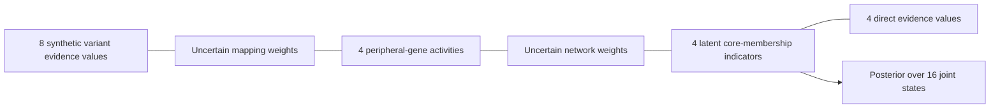
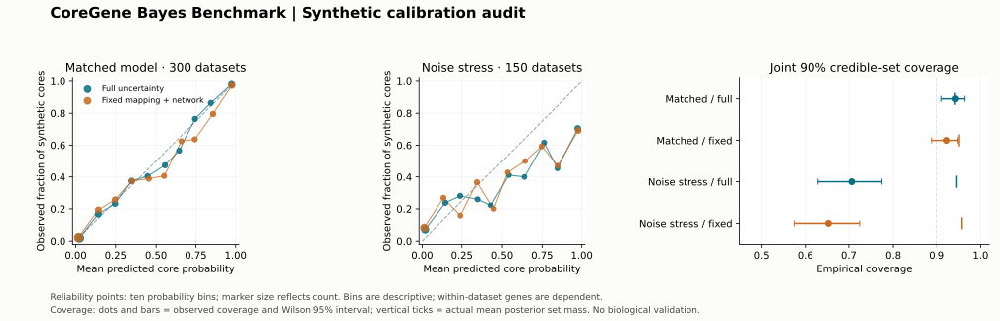

# CoreGene Bayes Benchmark

[](https://github.com/Zinga18018/coregene-bayes-benchmark/actions/workflows/tests.yml)

**A small, auditable experiment in propagating uncertainty through a synthetic variant–gene–core-gene cascade.**

**Development snapshot:** September 2026<br>
**Initial public release:** 25 September 2026

This is an educational portfolio prototype. All identifiers, observations, network weights and ground-truth labels are synthetic. This repository is not a GWAS analysis, a validated gene-prioritisation method, or evidence of a therapeutic discovery.

## The question

When both variant-to-gene mapping and gene-to-core propagation are uncertain, what changes if we integrate those uncertainties instead of replacing them with their means?

The implementation defines a generative model, enumerates its 16 possible core-membership states, and integrates continuous Beta-distributed weights using deterministic quadrature. It returns a posterior under that explicit toy model. It also deliberately increases the simulated noise without informing inference to demonstrate that correctly implemented Bayesian inference can still become overconfident under model misspecification.



The diagram shows evidence relationships, not established biological causal directions. The exact likelihood factorisation is in [METHOD.md](METHOD.md).

## What runs

- Fully specified simulation, with hidden ground truth separated from inference inputs.
- Exact enumeration of four binary core indicators; numerical integration of mapping and shared network weights.
- Five inference variants: full uncertainty, fixed mapping, fixed network, both fixed, and a network-removal stress baseline.
- Missing evidence is omitted from the likelihood. An absent measurement is never treated as a zero effect.
- Prior-predictive evaluation with Brier score, log loss, descriptive reliability bins, and joint credible-set coverage.
- Independent analytic-limit tests, a quadrature convergence check, source hashes, synthetic datasets and actual predictions.

## Quick start

Python 3.10+ and NumPy are the only runtime requirements.

```bash
python -m pip install -e .
python -m unittest discover -s tests -v
python -m coregene_bayes.cli --seed 20260925 --replicates 300 --stress-replicates 150 --output results
```

For a fast smoke run, use `--replicates 3 --stress-replicates 2 --output smoke-results`.

The command creates an output directory and overwrites its generated benchmark files if present. Use a new `--output` directory to preserve an earlier run.

## Recorded execution

The committed run used Python 3.12.14 and NumPy 2.3.5. **Eleven tests passed.** It generated **450 independent synthetic datasets** and **9,000 gene-level prediction rows**: 450 datasets × 5 models × 4 genes. No parameter was fitted or tuned on these datasets.

| Scenario | Model | Brier score ↓ | Joint 90% set coverage | Mean posterior mass of set |
|---|---|---:|---:|---:|
| Matched model; 300 datasets | Full uncertainty | 0.0754 | 0.943 | 0.942 |
| Matched model; 300 datasets | Fixed mapping and network | 0.0775 | 0.923 | 0.952 |
| Noise misspecification; 150 datasets | Full uncertainty | 0.1538 | 0.707 | 0.946 |

The small score difference between full uncertainty and the fixed-weight baseline is descriptive; this run does not establish statistical superiority. The misspecified-noise result is a failure case: integrating uncertainty did not protect coverage against an incorrect likelihood. Discrete joint sets generally carry more than 90% posterior mass, which is why their actual mass is reported alongside coverage.

Read the complete [results](results/RESULTS.md), [metrics and uncertainty intervals](results/summary.json), [calibration bins](results/calibration.csv), [quadrature check](results/convergence.json), [execution metadata](results/run_metadata.json), [test log](results/test-log.txt), and [benchmark log](results/benchmark-log.txt). Numbers are generated toy-model results, not biomedical performance claims.



To recreate the figure from the recorded outputs:

```bash
python -m pip install -e ".[plots]"
python scripts/plot_results.py --results results
```

## Relevance to statistical genetics

The [University of Lausanne Statistical Genetics Group's 2027 fellowship project](https://wp.unil.ch/sgg/2027-fbm-phd-fellowship-applications/) proposes a probabilistic variant → gene → core gene → disease framework. This prototype exercises one tractable part of that methodological direction: preserving uncertainty across intermediate mappings and checking posterior behaviour against known simulated truth.

It does **not** implement eQTL/pQTL colocalisation, Mendelian randomisation, rare-variant burden testing, Perturb-seq integration, LD-aware fine-mapping, disease prediction or therapeutic actionability. There is no institutional affiliation or endorsement implied.

The Allen Human Brain Atlas is not used here. Brain expression context and cardiometabolic target inference require different biological validation; substituting one for the other would not demonstrate alignment with the lab's disease focus.

## Repository map

| Path | Purpose |
|---|---|
| `coregene_bayes/model.py` | Generative model, quadrature and posterior inference |
| `coregene_bayes/cli.py` | Simulation, ablation benchmark and results export |
| `tests/test_model.py` | Mathematical limits, independent enumeration and input handling |
| `METHOD.md` | Equations, assumptions, metrics and limits |
| `SOURCE_MANIFEST.json` | Primary methodological/context references and provenance |
| `results/` | Executed synthetic inputs, predictions, metrics and logs |
| `.github/workflows/tests.yml` | Test and smoke-run workflow; remote CI status must be checked separately |

## Next research steps

1. Benchmark correlated observations and shared mapping uncertainties, including simulated LD and deliberate dependency violations.
2. Replace stipulated Beta distributions with evidence models that distinguish annotation confidence from biological effect magnitude.
3. Develop scalable inference and compare it with exact enumeration on small problems.
4. Specify tissue, ancestry, phenotype and evidence independence before attempting any public-data application.
5. Separate held-out biological validation from prior-predictive calibration; establish a defensible target-actionability definition with domain review.

These steps are proposals, not completed work. See [CONTRIBUTING.md](CONTRIBUTING.md) for claim and data boundaries.
