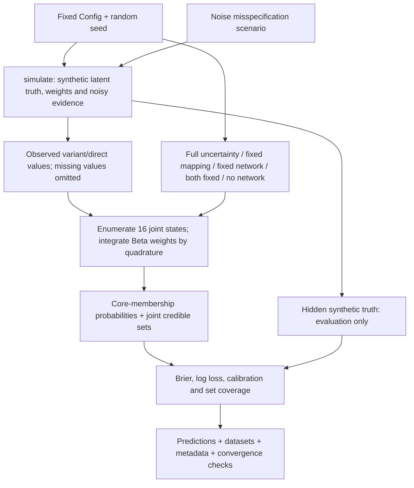

# How the synthetic benchmark works

This workflow separates simulation truth from inference inputs, then evaluates five inference variants on the same synthetic datasets. It does not use real genes or FinnGen data.

| Decision | Implementation | Consequence |
|---|---|---|
| Four binary core indicators | `states_and_prior` in [model.py](coregene_bayes/model.py) | All 16 joint states can be enumerated; this is a small reference model. |
| Integrate uncertain weights | `beta_quadrature`, `PreparedModel` in [model.py](coregene_bayes/model.py) | Continuous integration is numerical; a convergence check accompanies the outputs. |
| Keep truth out of inference | `run` in [cli.py](coregene_bayes/cli.py) passes only variant/direct observations to `infer` | Known synthetic labels can evaluate posterior behavior without becoming inputs. |
| Compare uncertainty assumptions | `PreparedModel.MODES` in [model.py](coregene_bayes/model.py) | Ablations isolate mapping/network assumptions under the stipulated model. |
| Stress the likelihood | `noise_multiplier` in [model.py](coregene_bayes/model.py), scenario loop in [cli.py](coregene_bayes/cli.py) | Integrating uncertainty can still be overconfident under misspecification. |
| Report finite-run uncertainty | `summarize` in [cli.py](coregene_bayes/cli.py) | Replicate-based score uncertainty and Wilson coverage intervals accompany point estimates. |

For equations and assumptions, read [METHOD.md](METHOD.md). For what actually ran, read [results/RESULTS.md](results/RESULTS.md). The small observed Brier difference does not establish superiority, and simulated calibration is not biological validation.
